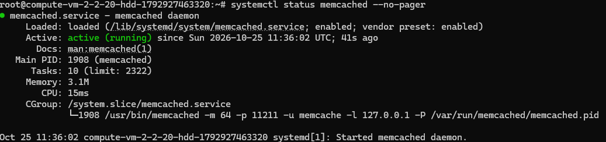
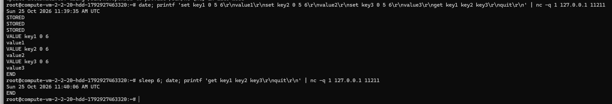
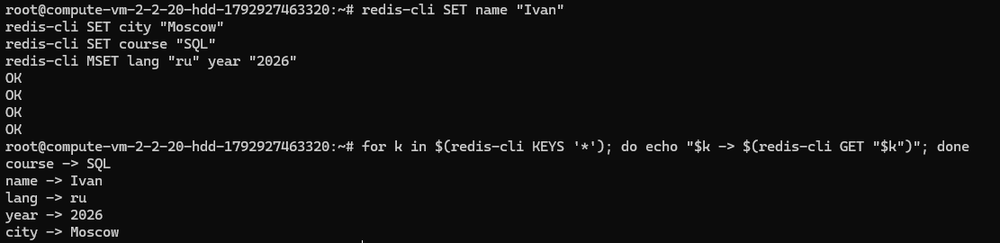

# Домашнее задание к занятию «Кеширование Redis/Memcached»

---

## Задание 1. Кеширование

**Примеры проблем, которые может решить кеширование:**

1. **Высокая нагрузка на базу данных.** Одни и те же запросы (каталог товаров, главная страница) выполняются тысячи раз. Кеш отдаёт готовый результат, и БД получает один запрос вместо тысячи.
2. **Медленные тяжёлые запросы.** Отчёты и аналитика с JOIN, агрегатами и сортировкой могут выполняться секундами. Результат можно пересчитывать раз в час и отдавать из кеша мгновенно.
3. **Большое время отклика.** Чтение из оперативной памяти занимает доли миллисекунды, а запрос к диску или по сети — миллисекунды и секунды. Кеш ускоряет загрузку страниц и ответы API.
4. **Повторные вычисления.** Рендеринг HTML, генерацию превью, подсчёт рейтингов и рекомендаций достаточно выполнить один раз и переиспользовать результат.
5. **Медленные, платные или ограниченные внешние API.** Кеширование ответов (курсы валют, погода, геокодирование) экономит деньги и защищает от превышения лимитов (rate limit).
6. **Хранение сессий и временных данных.** Сессии, корзины, токены и одноразовые коды удобно хранить в кеше с TTL, не нагружая основную БД.
7. **Масштабирование.** Кеш позволяет обслуживать больше пользователей на той же инфраструктуре.
8. **Устойчивость при сбоях.** Если источник данных недоступен, приложение может временно отдавать данные из кеша вместо ошибки.
9. **Снижение сетевого трафика.** CDN и браузерный кеш хранят статику ближе к пользователю.

Главная сложность кеширования — инвалидация: данные в кеше могут устареть. Поэтому кешируют прежде всего то, что часто читается и редко меняется, и задают разумный TTL.

---

## Задание 2. Memcached

Установка и запуск:

```bash
sudo apt update
sudo apt install -y memcached libmemcached-tools
sudo systemctl enable --now memcached
systemctl status memcached --no-pager
```

Служба запущена (`Active: active (running)`):



---

## Задание 3. Удаление по TTL в Memcached

Запись трёх ключей с TTL = 5 секунд и их чтение сразу после записи:

```bash
date; printf 'set key1 0 5 6\r\nvalue1\r\nset key2 0 5 6\r\nvalue2\r\nset key3 0 5 6\r\nvalue3\r\nget key1 key2 key3\r\nquit\r\n' | nc -q 1 127.0.0.1 11211
```

Повторное чтение спустя больше 5 секунд:

```bash
sleep 6; date; printf 'get key1 key2 key3\r\nquit\r\n' | nc -q 1 127.0.0.1 11211
```

Сразу после записи ключи возвращаются со значениями, а после истечения TTL ответ содержит только `END`, то есть ключи удалены:



---

## Задание 4. Запись данных в Redis

Установка:

```bash
sudo apt install -y redis-server
sudo systemctl enable --now redis-server
```

Запись ключей:

```bash
redis-cli SET name "Ivan"
redis-cli SET city "Moscow"
redis-cli SET course "SQL"
redis-cli MSET lang "ru" year "2026"
```

Получение всех ключей и значений:

```bash
for k in $(redis-cli KEYS '*'); do echo "$k -> $(redis-cli GET "$k")"; done
```


